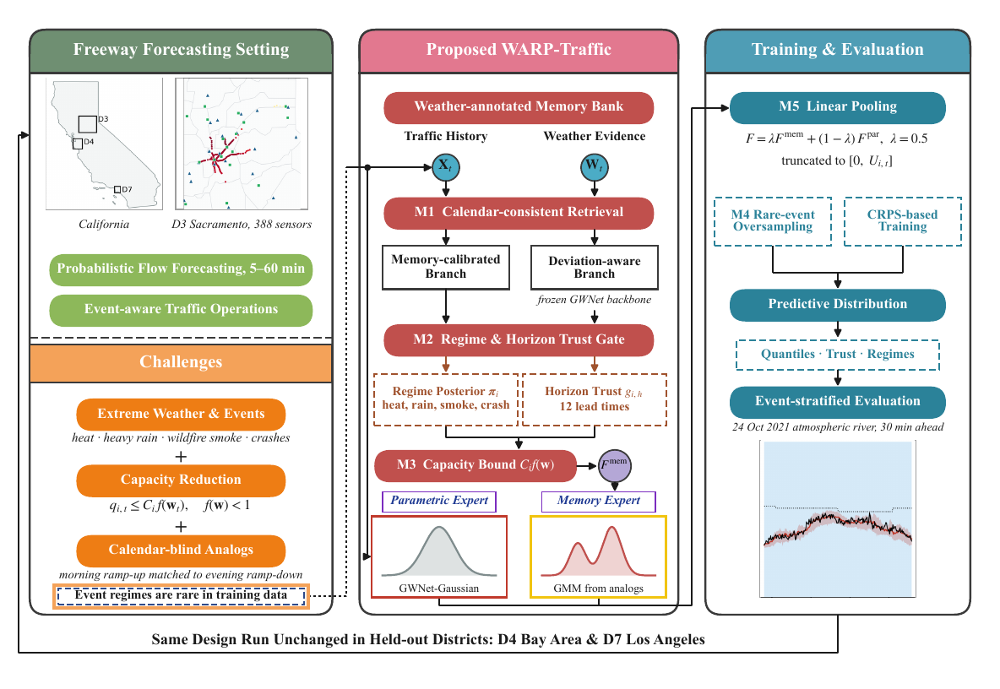
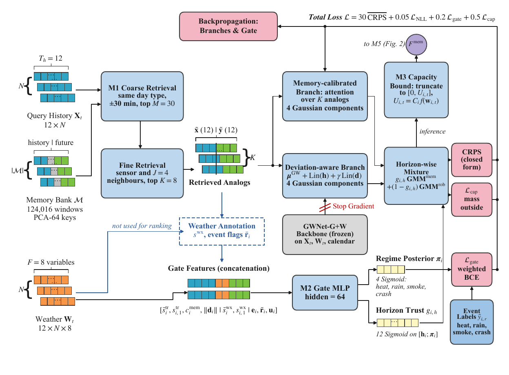
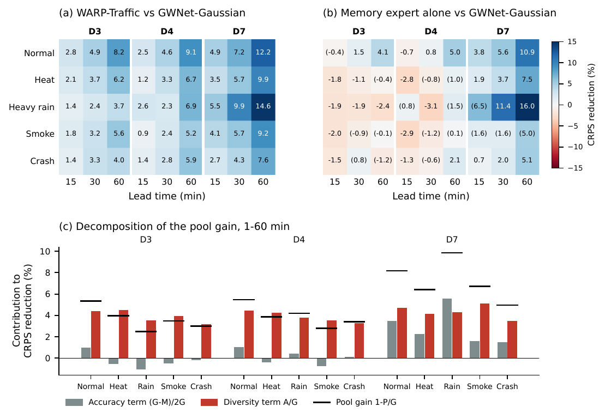

# WARP-Traffic: Weather-Aware Retrieval Pooling for Probabilistic Freeway Forecasting under Extreme Weather

## Overview

A research framework for probabilistic short-term freeway flow forecasting on unusual days: extreme heat, heavy rain, wildfire smoke and crashes. Deep forecasters are trained and evaluated on data dominated by normal conditions, so it is unclear whether their forecasts stay accurate and calibrated when conditions depart from them. WARP-Traffic pools two experts. A **memory expert** retrieves historical traffic analogs and decides how much to trust them from the lead time and the inferred event regime. A **parametric expert** is a probabilistic graph network. The pooled forecast stays inside a weather-adjusted capacity envelope. The framework is evaluated on five years (2017–2021) of 5-min flow from 1,579 sensors in three Californian districts, linked to weather, air-quality, smoke and crash records.



This project provides:

- **WARP-Traffic** — A retrieval-guided probabilistic forecaster that pools a weather-aware memory of historical analogs with a parametric spatiotemporal graph network.
- **Model Benchmarking** — Statistical, deterministic, probabilistic, weather-aware, retrieval-guided and pooled baselines, trained and scored under one protocol.
- **Event-Stratified Evaluation** — CRPS, calibration and admissibility by event type (heat, heavy rain, smoke, crash) and lead time (5–60 min), with event-level bootstrap tests.
- **Data Pipeline** — Scripts that link LargeST freeway flow to sensor-level weather, PM2.5, smoke-plume and crash records and build event labels.
- **Decision Analysis** — Cost–loss value and alert operating points for near-capacity and demand-drop alerts.

## Repository Structure

```
WARP-Traffic/
├── wremind/                      # Models, training and evaluation
│   ├── models.py                 # Memory expert (M1–M4) built on the REMIND components
│   ├── baselines.py              # Graph WaveNet, STAEformer, STID, DeepAR and output heads
│   ├── stat_baselines.py         # Historical average, seasonal naive, climatology
│   ├── data.py                   # Region loader, memory bank, event flags
│   ├── metrics.py                # CRPS, energy score, coverage, ECE, violation rate
│   ├── train.py                  # Training and test-year evaluation of one model
│   ├── pool.py                   # Forecaster-level linear pooling (M5), truncated sampling
│   └── reeval.py                 # Re-evaluate a trained run (sensor outages, weather noise)
├── data_pipeline/
│   ├── s1_extract_traffic.py     # District 3/4/7 flow from the LargeST yearly files
│   ├── s2_weather.py             # Hourly ASOS weather and EPA PM2.5 station grids
│   ├── s3_traffic.py             # Quality control, gap filling, graph, capacity estimates
│   ├── s3b_observed_mask.py      # Mask of observed (not interpolated) flow values
│   └── s4_exog.py                # Sensor-level exogenous inputs, event labels, capacity factors
├── analysis/
│   ├── e1_drift.py               # Empirical event-induced shift (regression, matched days)
│   ├── aggregate.py              # Seed averages, event strata, Diebold–Mariano tests
│   ├── e5_interpret.py           # Trust gate and regime posteriors
│   ├── e8_decision.py            # Cost–loss value of alerts
│   ├── e9_event_level.py         # Event-level inference and calibration
│   ├── e10_conditions.py         # Gain by condition, lead time and district; alert operating points
│   ├── make_tables.py            # LaTeX tables
│   ├── make_macros.py            # Numbers quoted in the paper text
│   └── fig_*.py                  # Figures
├── experiments/
│   ├── queue.py                  # Serial GPU job queue
│   └── queue*_done.txt           # Every command that produced the reported results
├── remind_core/                  # REMIND reference implementation (obtain separately, see Requirements)
└── assets/                       # Figures used in this README
```

## Methods

### WARP-Traffic Architecture

WARP-Traffic combines two experts at the level of their predictive distributions:

- **Memory expert (retrieval-guided):**
  - **M1, calendar-consistent retrieval.** Analogs come from the same day type within ±30 min of the time of day, and are annotated with weather similarity and event history.
  - **M2, regime- and horizon-aware trust gate.** A CRPS-trained gate gives one trust weight per lead time and is informed by inferred heat, rain, smoke and crash regimes.
  - **M3, capacity-consistent forecasts.** The predictive mixture is truncated to `[0, C_i · f(w)]`, where `f(w)` is the Highway Capacity Manual adjustment for rain and visibility.
- **Parametric expert:** A Graph WaveNet with a Gaussian head and no weather inputs.
- **Linear pooling (M5):** The final forecast is the equal-weight pool of the two experts, truncated to the same envelope.

Under the CRPS, a linear pool improves on the weighted average of its experts' scores by `λ(1−λ)` times the Cramér distance between them. The memory expert is a useful partner because its distribution differs from the parametric network's, also in conditions where it is less accurate on its own.



### Baseline Models

| Model | `--model` | Key Characteristics |
|---|---|---|
| Historical average, seasonal naive, climatology | `wremind.stat_baselines` | Statistical references |
| GWNet / STAEformer + conformal | `gwnet`, `staeformer` | Deterministic network with split-conformal intervals |
| GWNet-Gaussian | `gwnet_gauss` | Graph WaveNet with Gaussian head (strongest single baseline) |
| GWNet-Quantile, STAEformer-Quantile | `gwnet_quantile`, `staeformer_quantile` | Pinball loss on 19 quantile levels |
| DeepAR | `deepar` | Autoregressive likelihood model |
| GWNet-Gaussian+W | `gwnet_gauss+wx` | Eight weather features concatenated to the inputs |
| REMIND | `remind`, `remind_wx` | Retrieval-guided forecaster with a scalar similarity gate |
| Pooled controls | `wremind.pool` | Deep ensemble, GWNet-G ⊕ GWNet-G+W, REMIND ⊕ GWNet-G |
| **WARP-Traffic** | `wremind` + `wremind.pool` | Memory expert pooled with GWNet-Gaussian (proposed) |

### Evaluation

- CRPS from 100 predictive samples and energy score of the 12-step trajectory
- Coverage and width of the central 90% interval, Winkler score, calibration error
- Violation rate: share of samples outside the weather-adjusted capacity envelope
- Strata: all, normal, heat, heavy rain, smoke and crash cells at 15, 30 and 60 min
- Diebold–Mariano tests with Holm correction, and bootstrap over independent events

## Results

CRPS (veh/5 min, 12-step average) on the 2021 test year. D3 averages three seeds, D4 and D7 two seeds.

| Model | D3 Sacramento | D4 Bay Area core | D7 Los Angeles core |
|---|---|---|---|
| GWNet-Gaussian | 11.99 | 14.48 | 17.77 |
| GWNet-Gaussian+W | 11.88 | 14.63 | 17.42 |
| GWNet-G ⊕ GWNet-G+W | 11.77 | 14.49 | 17.43 |
| REMIND | 12.20 | 14.42 | 17.33 |
| REMIND ⊕ GWNet-G | 11.57 | 13.93 | 16.88 |
| WARP-Traffic memory expert | 11.78 | 14.20 | 16.57 |
| **WARP-Traffic** | **11.37** | **13.70** | **16.34** |



## Data

No data are redistributed here. All sources are public:

| Source | Content | Link |
|---|---|---|
| LargeST (Caltrans PeMS) | 5-min mainline flow, sensor metadata, adjacency, 2017–2021 | [github.com/liuxu77/LargeST](https://github.com/liuxu77/LargeST) |
| Iowa Environmental Mesonet | Hourly ASOS weather (65 stations) | [mesonet.agron.iastate.edu](https://mesonet.agron.iastate.edu/request/download.phtml) |
| EPA Air Quality System | Hourly PM2.5 (122 monitors) | [aqs.epa.gov](https://aqs.epa.gov/aqsweb/airdata/download_files.html) |
| NOAA Hazard Mapping System | Daily smoke-plume polygons | [ospo.noaa.gov](https://www.ospo.noaa.gov/products/land/hms.html) |
| US-Accidents | Crash records for California | [smoosavi.org](https://smoosavi.org/datasets/us_accidents) |
| PEMS-BAY | Speeds for the speed–flow analysis | [github.com/liyaguang/DCRNN](https://github.com/liyaguang/DCRNN) |

The pipeline writes one folder per district (`data_proc/regions/D3`, `D4`, `D7`) with `flow.npy`, `observed.npy`, `adj.npy`, `capacity.npy`, `wx_hourly.npy`, `events.npy` and `meta.csv`. Training covers 1 January 2017 to 31 October 2020 without the stay-at-home period of 15 March to 30 June 2020. Validation is November and December 2020, and the test year is 2021.

## Requirements

```
python>=3.12
torch>=2.6.0
numpy
pandas
scipy
scikit-learn
statsmodels
h5py
pyarrow
geopandas
matplotlib
easydict
```

The memory expert imports the encoder, branches and losses of REMIND unchanged. Clone the reference implementation into `remind_core/`:

```bash
git clone https://github.com/LvHaochenBANG/REMIND remind_core
```

> **Note:** A CUDA GPU is required. The reported runs used one NVIDIA RTX 3090 (24 GB) with PyTorch built for CUDA 12.4, installed from [pytorch.org](https://pytorch.org/). Run GPU jobs one at a time.

All paths are relative to the repository. Data and outputs live next to it, in the parent folder:

```
<project>/
├── WARP-Traffic/     # this repository
├── data_raw/         # downloads: largest/, asos/, epa/, hms/, accidents/, pemsbay/, census/, firststreet/
├── data_proc/        # written by data_pipeline/
├── results/          # written by wremind.train and wremind.pool
├── logs/             # written by experiments/queue.py
└── paper/figures/    # written by analysis/fig_*.py
```

## Usage

### 1. Build the Data

```bash
python data_pipeline/s1_extract_traffic.py
python data_pipeline/s2_weather.py asos pm25
python data_pipeline/s3_traffic.py
python data_pipeline/s3b_observed_mask.py
python data_pipeline/s4_exog.py D3 D4 D7
```

### 2. Train the Experts

```bash
python -m wremind.train --region D3 --model gwnet_gauss --seed 0 --save_extra
python -m wremind.train --region D3 --model gwnet_gauss+wx --seed 0 --save_extra
python -m wremind.train --region D3 --model wremind --seed 0 --save_extra
```

`gwnet_gauss` is the parametric expert. `gwnet_gauss+wx` is the frozen backbone of the memory expert and must be trained before `wremind`. Each run writes `summary.json`, `series.npz` and `train.log` to `results/<region>/<model>_s<seed>/`.

**Key hyperparameters** (command-line arguments of `wremind.train`):

| Parameter | Default | Description |
|---|---|---|
| `--epochs` | 20 | Maximum training epochs |
| `--n_epoch` | 16000 | Training windows per epoch |
| `--patience` | 4 | Early-stopping patience on validation loss |
| `--bs` | 16 | Mini-batch size |
| `--hidden` | 64 | Hidden size of the memory expert |
| `--M` | 30 | Coarse retrieval candidates |
| `--K` | 8 | Node-level analogs kept per sensor |
| `--tod_window` | 6 | Calendar window of M1 in 5-min steps (±30 min) |
| `--alpha` | 1.0 | Traffic weight in the retrieval score (below 1 adds weather similarity) |
| `--lambda_gate` | 0.2 | Weight of the regime supervision loss |
| `--samples` | 100 | Predictive samples per forecast |

### 3. Pool the Experts (WARP-Traffic)

```bash
python -m wremind.pool --region D3 --a wremind_s0 --b gwnet_gauss_s0 --name wremindpool --seed 0 --save_extra
```

Draws from the truncated equal-weight pool of the memory expert (`--a`) and the parametric expert (`--b`). Use `--w` to change the pool weight.

### 4. Run Baselines, Controls and Ablations

```bash
python -m wremind.stat_baselines --region D3
python -m wremind.train --region D3 --model staeformer_quantile --seed 0
python -m wremind.train --region D3 --model remind --seed 0 --backbone gwnet
python -m wremind.pool --region D3 --a remind_s0 --b gwnet_gauss_s0 --name remindpool --seed 0
python -m wremind.train --region D3 --model wremind_noM2 --seed 0
```

The files `experiments/queue*_done.txt` list every command behind the reported results, including the held-out districts, the robustness runs (`--node_frac`, `--wx_noise`, `--wx_drop`) and the module ablations.

### 5. Aggregate Results and Draw Figures

```bash
python analysis/aggregate.py D3 D4 D7
python analysis/e9_event_level.py
python analysis/e10_conditions.py
python analysis/make_tables.py D3
```

## Citation

The paper describing WARP-Traffic is in preparation. Citation details will be added here.

## Acknowledgements

- [REMIND](https://github.com/LvHaochenBANG/REMIND) for the retrieval-guided forecasting components
- [LargeST](https://github.com/liuxu77/LargeST) for the multi-year freeway benchmark
- [PyTorch](https://pytorch.org/) for deep learning infrastructure
- [Graph WaveNet](https://github.com/nnzhan/Graph-WaveNet) and [STAEformer](https://github.com/XDZhelheim/STAEformer) for the baseline architectures
- Iowa Environmental Mesonet, EPA AQS, NOAA HMS and US-Accidents for the open weather, air-quality, smoke and crash data
